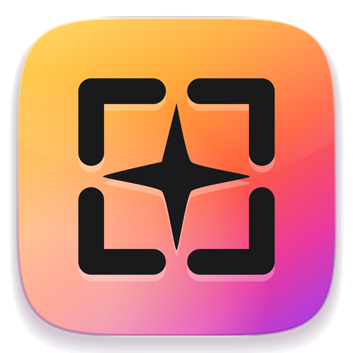

<h1 align="center">Koji</h1>

Snip, mark up, record. A tiny native screenshot and screen recording app for Windows.

<a href="https://github.com/jxfriis/koji/releases/latest/download/Koji.exe"><b>Download Koji.exe</b></a> · <a href="https://koji-app.pages.dev">Website</a>

- **Snip** with PrtSc or Win+Shift+S: drag a region, click a window, or press F for the full screen
- **Annotate**: pen, highlighter, arrows, lines, boxes, ellipses, text, numbered steps, spotlight, pixelate, crop, smart shape cleanup
- **Copy text** (OCR) with Ctrl+T, **search** with Google Lens with Ctrl+G
- **Add snip**: drop a second capture into the first, then move, resize, crop, border or shadow it
- **Record** the screen at 60 fps to H.264 MP4
- Light, dark and Sunset themes, seven accent colors, two app icons

One ~1 MB exe, written in Rust. No installer, no account, no telemetry. Windows 10 and 11 (x64).

Koji isn't code-signed yet, so Windows may show a SmartScreen prompt the first time: choose **More info → Run anyway**.

This repository hosts the releases.
